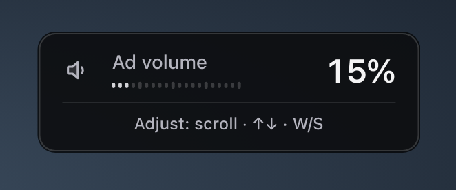
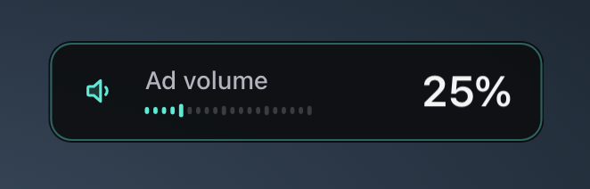

# Quiet Ads

Commercials on streaming sites play at 15% of your volume. When your show comes back, your volume does too.

## How to use it

Watch something. When a commercial starts, the sound drops and a small volume indicator appears.

To make commercials louder or quieter, scroll your mouse wheel over the video, or press ↑ ↓ or W S. Each step is 5%, and Quiet Ads remembers your pick on that computer.

While your show plays, the wheel and those keys do what they always do.

## Where it works

YouTube, Netflix, Hulu, Disney+, Max, Peacock, Prime Video, Paramount+, Pluto TV, Tubi, The Roku Channel, Plex, ESPN, discovery+, Twitch, NBC, CBS, Fandango at Home and Dailymotion, plus many other sites built on the common video players (PBS, AMC and NBC News, for example).

In Chrome, Edge, Brave, Vivaldi, Opera and Firefox, on Mac, Windows and Linux.

Commercials inside a live TV broadcast look the same as the show to a browser, so those play at your normal volume.

## Get it

The easy way: ask your AI (Claude or ChatGPT, for example) to "install Quiet Ads from github.com/DrAlexHarrison/littlethings". The steps it needs are in this repo.

By hand, in Chrome:

1. On [github.com/DrAlexHarrison/littlethings](https://github.com/DrAlexHarrison/littlethings), click the green Code button, then Download ZIP, and unzip it.
2. Inside `quiet-ads` there is a folder named `extension`. Move it somewhere it can stay, like your home folder.
3. Type `chrome://extensions` in the address bar. Turn on Developer mode (top right) and leave it on.
4. Click Load unpacked and pick that `extension` folder.
5. Reload any streaming tabs you had open.

In Firefox: open [quiet-ads-1.1.0.xpi](https://github.com/DrAlexHarrison/littlethings/releases/download/quiet-ads-v1.1.0/quiet-ads-1.1.0.xpi) in Firefox. It asks before installing; choose Continue to Installation, then Add.

## Good to know

Quiet Ads runs on your computer and sends nothing anywhere.

To switch it off on one site in Chrome, right-click the Quiet Ads icon in your toolbar and choose "This can read and change site data".

Sites change their players now and then. If commercials on one stop getting quieter, your AI can fix it; [AGENTS.md](../AGENTS.md) shows where.

Free. If it makes your evenings quieter, you can [buy me a coffee](https://buymeacoffee.com/dralexharrison). :)
